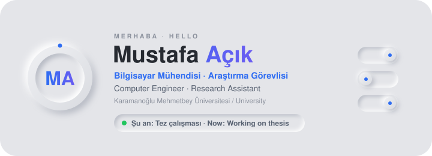
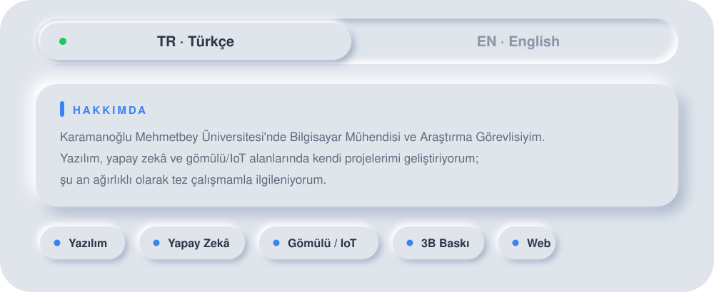
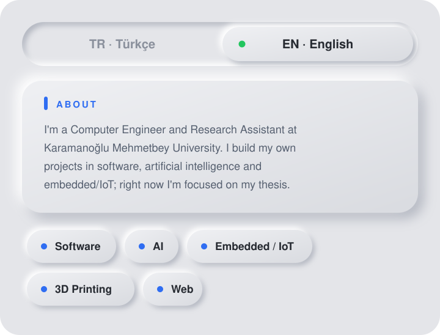
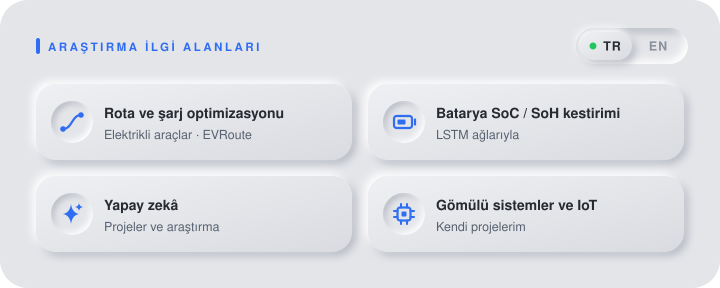
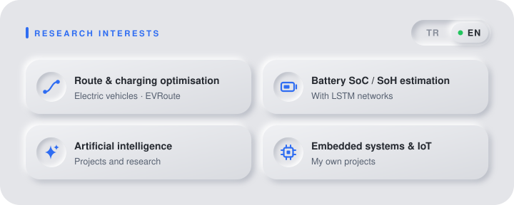

<picture><source media="(prefers-color-scheme: dark)" srcset="assets/hero-dark.svg"></picture>

<a href="https://macik.com.tr"><picture><source media="(prefers-color-scheme: dark)" srcset="assets/pill-web-dark.svg"></picture></a>&nbsp;<a href="mailto:mustafaacik92@gmail.com"><picture><source media="(prefers-color-scheme: dark)" srcset="assets/pill-mail-dark.svg"></picture></a>

<picture><source media="(prefers-color-scheme: dark)" srcset="assets/section-tr-dark.svg"></picture>

<picture><source media="(prefers-color-scheme: dark)" srcset="assets/section-en-dark.svg"></picture>

<picture><source media="(prefers-color-scheme: dark)" srcset="assets/research-tr-dark.svg"></picture>

<picture><source media="(prefers-color-scheme: dark)" srcset="assets/research-en-dark.svg"></picture>

<a href="https://github.com/Aseloth99/evroute"><picture><source media="(prefers-color-scheme: dark)" srcset="assets/project-tr-dark.svg"></picture></a>

<a href="https://github.com/Aseloth99/evroute"><picture><source media="(prefers-color-scheme: dark)" srcset="assets/project-en-dark.svg"></picture></a>

 
Karaman → İstanbul · iki şarj molası / two charging stops · <a href="https://github.com/Aseloth99/evroute">Depo / Repository</a>

 

İletişim / Contact: <a href="mailto:mustafaacik92@gmail.com">mustafaacik92@gmail.com</a> · <a href="https://macik.com.tr">macik.com.tr</a>

